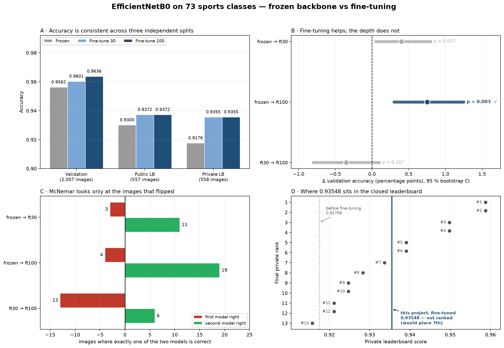

# Sport Image Classification — from Feature Extraction to Fine-Tuning


Classifying sports images into **73 classes** (air hockey, basketball, curling,
figure skating, …) with an ImageNet-pretrained **EfficientNetB0**. Two phases
are measured and compared: a frozen backbone (feature extraction), then partial
fine-tuning at a reduced learning rate.

| Model | Val (2,007) | Public (557) | Private (558) |
|---|---|---|---|
| Frozen backbone (published run) | 0.9567 | 0.92998 | 0.91756 |
| + fine-tune, last 30 layers | 0.9601 | 0.93716 | **0.93548** |
| + fine-tune, last 100 layers | **0.9636** | 0.93716 | **0.93548** |

*Fine-tuning started from a fresh reproduction of the frozen run (validation
0.9562), not from the 0.9567 checkpoint of the original notebook, which was no
longer available. The +0.75 pt validation gain is measured against that
reproduction.*

> **Note on ranking.** The competition closed before these submissions were
> made, so they are marked *"Complete (after deadline)"* and appear in no
> final standings. 0.93548 would sit between the 6th (0.93906) and 7th
> (0.93369) private scores. **No rank is claimed** — the score is reported, the
> ranking is not.

> **Note on the two phases.** Phase 1 freezes the backbone: that is *feature
> extraction*. Phase 2 unfreezes the last N layers: that is *fine-tuning*. The
> published 0.91756 came from phase 1 alone. Both are now measured, and the
> difference between them turned out to be the point of the project.

---



*Panel A — the same three models on three independent splits. Panel B — paired
difference with its 95 % bootstrap confidence interval; only the 100-layer
model separates from the frozen one. Panel C — the images that flipped, which
is all an exact McNemar test looks at. Panel D — where the fine-tuned private
score would sit in the closed leaderboard. Panel A's vertical axis starts at
0.90, not at zero.*

---

## The problem

- 73 classes, ~140 images per class on average
- 10,031 labelled training images, 1,115 test images
- No separate validation set: one had to be carved out of the training data
- Images of varying sizes

## Why transfer learning

I first trained a CNN from scratch. It reached **~25 % accuracy** and remained
unstable: with 73 classes and ~10,000 images, there is not enough signal to
learn rich visual features from random initialisation.

Switching to an ImageNet-pretrained EfficientNetB0 — frozen — and training only
a new head took validation accuracy to **95.7 %**. That contrast is the single
most useful thing I took from this project.

## Approach

```
train.csv + images/                     (10,031 labelled images)
        │
        ▼
NumPy loading (PIL, resize 224×224, uint8 0–255)
        │
        ▼
Stratified split 80 / 20        (8,024 train / 2,007 validation)
        │
        ▼
EfficientNetB0 (ImageNet, frozen)  ── phase 1 ──┐
        │                                       │
        ▼                                       │
GAP → BatchNorm → Dropout 0.5 → Dense(256) → BatchNorm → Dropout 0.5 → Dense(73)
        │
        ▼
Adam 1e-3 · 20 epochs · early stopping on val_accuracy (patience 10)
        │
        ▼
unfreeze last N layers · backbone BatchNorm stays frozen · recompile at 1e-5
        │                                        ── phase 2 ──┘
        ▼
15 epochs · same callbacks → predict → submission.csv (ID, CLASS)
```

**Note on preprocessing.** Keras' EfficientNetB0 includes its own
`Rescaling(1/255)` and `Normalization` layers: it expects **raw 0–255 pixels**.
Dividing by 255 beforehand would rescale twice and break the model. The
`preprocess_input` function from `keras.applications.efficientnet` is a
pass-through for this architecture — it exists for API consistency, not because
it does anything.

## Fine-tuning: measured, and depth did not matter

| Unfrozen layers | Trainable params | Val (2,007) | Public (557) | Private (558) |
|---|---|---|---|---|
| 0 (frozen) | 349,769 | 0.9562 | 0.92998 | 0.91756 |
| 30 | 1,833,129 | 0.9601 | 0.93716 | **0.93548** |
| 100 | 3,798,909 | 0.9636 | 0.93716 | **0.93548** |

*The frozen row pairs the reproduction's validation score (0.9562) with the
original notebook's leaderboard scores — no frozen model from this session was
submitted.*

Every model is evaluated on the *same* 2,007 validation images, so the
comparisons are paired and were tested with an **exact McNemar test** on the
discordant pairs, plus a paired bootstrap confidence interval of the
difference. Comparing two accuracies without that test is not a comparison —
on 2,007 images, one point is 20 images.

| Comparison | Δ accuracy | 95 % CI of the difference | Discordant images | McNemar p |
|---|---|---|---|---|
| frozen → 100 layers | +0.75 pt | [+0.30 ; +1.25] | 23 (4 / 19) | **0.003** |
| frozen → 30 layers | +0.40 pt | [+0.05 ; +0.80] | 14 (3 / 11) | 0.057 |
| 30 → 100 layers | −0.35 pt | [−0.80 ; +0.10] | 19 (13 / 6) | 0.167 |

**Reading these numbers.**

1. **Fine-tuning works**: 100 layers beat the frozen backbone by 10 images out of
   558 private (512 → 522), and the gain is consistent across every split —
   +0.75 pt validation, +0.72 pt public, +1.79 pt private.
2. **The depth does not matter.** On validation, 100 layers looked 0.35 pt
   better than 30 — but that difference was already inside the noise (p = 0.167).
   The private leaderboard, an independent 558-image set, returned **exactly the
   same score** for both. Two independent evaluations, two different methods,
   one conclusion: what matters is fine-tuning at all, not how deep.
3. **Significance is not importance.** The +0.75 pt validation gain is 15 images
   and p = 0.003. It is real, and it is small. Both statements belong in the same
   sentence.

## Challenges & Solutions

| Challenge | Symptom | Solution |
|---|---|---|
| **`Lambda` layer inside the model** | `ModelCheckpoint` failed — the model could not be saved, then could not be reloaded | Removed the `Lambda`; preprocessing moved out of the model into the data pipeline. A `Lambda` wraps a Python function, which Keras cannot serialise. |
| **Input scaling** | Model learned nothing on early attempts | EfficientNet already rescales internally, so the input must stay in **0–255**. No `/255`. |
| **Debugging the pipeline** | Could not learn even a single batch (~3 % accuracy) | Tested on one batch before launching a full run. A model that cannot overfit one batch points to the data pipeline, not the architecture. |
| **Unfreezing without recompiling** | The backbone stayed effectively frozen: no error, no change | `model.compile()` must be called again after changing `layer.trainable`, otherwise Keras keeps the old graph. |
| **BatchNorm on small batches** | Fine-tuning destroyed the pretrained weights | Backbone `BatchNormalization` layers are re-frozen after unfreezing. With batches of 32, their moving statistics become noisy and overwrite the ImageNet ones. |
| **Comparing two runs** | A 0.4-point "improvement" that was four images | Exact McNemar test on discordant pairs, not a difference of accuracies. |
| **In-training vs re-measured accuracy** | Keras reported 0.9611 during `fit`, re-evaluation gave 0.9601 | The 0.10 pt gap comes from BatchNorm moving statistics. All reported numbers are recomputed by the same code path — an in-training metric is never compared with a re-measured one. |

## Results

### Where the model fails

Errors are concentrated on visually adjacent classes:

| Class | Error rate | Likely confusion |
|---|---|---|
| frisbee | 23.1 % | disc sports at distance |
| figure_skating_pairs | 20.7 % | vs. men / women |
| luge | 20.0 % | vs. bobsled |
| snow_boarding | 17.4 % | vs. ski jumping |
| pommel_horse | 13.0 % | gymnastics apparatus |

Seven classes are classified perfectly (F1 = 1.00): curling, harness racing,
polo, rings, snowmobile racing, wheelchair basketball, wheelchair racing.

*These per-class figures come from the frozen run. The confusion matrix in the
original notebook was computed on unprocessed inputs — it must be recomputed
before being quoted.*

### The validation gap, and what it taught me

Frozen model: validation 95.67 % → private 91.76 %, a **3.9-point gap**.

The validation set is a random 80/20 split *inside* the training set: images
from the same event, venue or photographer can land on both sides. The
validation score is therefore optimistic by construction. A grouped split — by
event or by image source — would give a validation score closer to the
leaderboard. **That is the first thing I would change.**

After fine-tuning the gap narrowed to 2.81 points (0.9636 → 0.93548). I would
not read too much into that on 558 private images.

The public-to-private gap, meanwhile, tells a different story: 1.24 pt for the
frozen model (≈ 7 images), 0.17 pt for the fine-tuned one. Both are ordinary
sampling noise on ~557 images, not evidence of overfitting.

### The mistake I made, and corrected

Having established that the validation set was contaminated, I predicted that a
validation gain would **not** transfer to the test set. I was wrong by 1.79
points.

The reasoning error is worth stating precisely, because it is a common one:

> A contaminated validation set **inflates absolute scores**. It does not
> **lose its power to rank models**. The contamination shifts every model
> upward by a roughly similar amount; the ordering survives.

I drew a conclusion about *ranking* from an observation about *bias*. The
absolute numbers from that validation set should never be quoted — the
comparisons between models remain valid, provided they are tested properly.

---

## What I learned

1. **Transfer learning beats from-scratch** by a factor of nearly four on this
   dataset (25 % → 96 % validation).
2. **A frozen backbone is feature extraction, not fine-tuning.** I initially
   described this project as fine-tuning; the code never unfroze the backbone.
   The distinction matters and I corrected it.
3. **Fine-tuning gained 1.8 points — but only after I measured it.** The
   published score came from phase 1 alone; the helper existed but was never
   called. An implemented method is not a measured one.
4. **Depth was noise, presence was signal.** 30 and 100 layers returned the same
   private score. The exact McNemar test predicted that before the submission
   did.
5. **A biased validation set still ranks models.** Bias in the absolute value
   does not destroy the ordering.
6. **Debug the pipeline on a single batch** before launching a full run. One
   batch that cannot be learned from points to the data pipeline, not the model.
7. **A `Lambda` layer is a trap.** It wraps a Python function, which Keras
   cannot serialise — so `ModelCheckpoint` fails and the model cannot be
   reloaded. Prefer moving preprocessing into the data pipeline, or use a
   serialisable `Rescaling` layer.
8. **Model-specific input conventions** matter more than they look: EfficientNet
   expects raw 0–255 because its rescaling is inside the model. Getting it wrong
   silently caps the accuracy.
9. **`restore_best_weights` and in-training metrics are not the same
   measurement.** Recompute everything with one code path, or compare nothing.
10. **Do not explain a result you did not isolate.** I first wrote that three
    settings "made fine-tuning work". None of the three was tested. The
    corrected text states the configuration and names the missing experiment.

---

## What I would improve next

1. **Grouped validation split** by event or image source, to remove the
   same-event optimism. This is the highest-value change remaining: it would
   turn the validation score into a trustworthy estimate.
2. **Class-balanced sampling** for the weakest classes (frisbee, pairs skating,
   luge).
3. **Test-time augmentation** on the 1,115 test images — cheap, and measurable
   with the same McNemar protocol.
4. **Higher input resolution** (260 or 300 px) — EfficientNetB0 accepts it, at
   the cost of retraining the head.

---

## Repository structure

```
├── config.py             paths and hyperparameters (phase 1 and phase 2)
├── src/
│   ├── data.py           NumPy loading, stratified split
│   ├── model.py          EfficientNetB0 + head, unfreeze helper
│   ├── train.py          phase 1 training, callbacks, class_names export
│   ├── finetune.py       phase 2: unfreeze N layers, retrain at 1e-5
│   ├── compare_ft.py     paired comparison: exact McNemar + bootstrap CI
│   ├── plot_summary.py   README figures (presentation only, measures nothing)
│   ├── evaluate.py       per-class report, normalised confusion matrix
│   └── predict.py        batched inference, any model, validated submission
├── results/              metrics, curves, confusion matrix, run comparison
└── requirements.txt
```

## How to reproduce

```bash
git clone https://github.com/Nasreddine-EL-MAMMERI/Sport-images-classification.git
cd Sport-images-classification

python -m venv .venv
.\.venv\Scripts\activate        # Windows
pip install -r requirements.txt
```

Place the competition data under `data/`:

```
data/
├── train.csv
├── test.csv
└── sports_images/all_images/    # flat folder of images
```

Then:

```bash
python -m src.train                              # phase 1 → models/best_model.keras
python -m src.finetune --unfreeze 100            # phase 2 → models/best_model_ft100.keras
python -m src.compare_ft                         # McNemar + bootstrap → results/
python -m src.plot_summary                       # README figures → results/
python -m src.evaluate                           # per-class report and figures
python -m src.predict                            # submission.csv
python -m src.predict --model models/best_model_ft100.keras \
                      --output submission_ft100.csv
```

On Kaggle, `config.py` resolves the competition directory automatically, for
both the current `/kaggle/input/competitions/<slug>` mount and the older
`/kaggle/input/<slug>` one.

## Tech stack

Python 3.10+ · TensorFlow 2.18 / Keras · EfficientNetB0 (ImageNet) · NumPy ·
pandas · PIL · scikit-learn · Matplotlib · Seaborn

## Dataset

[Kaggle — OpenCV TF Project-2 Image Classification: Round 4](https://www.kaggle.com/competitions/opencv-tf-project-2-image-classification-round-4)

## License

MIT — see [LICENSE](LICENSE).
